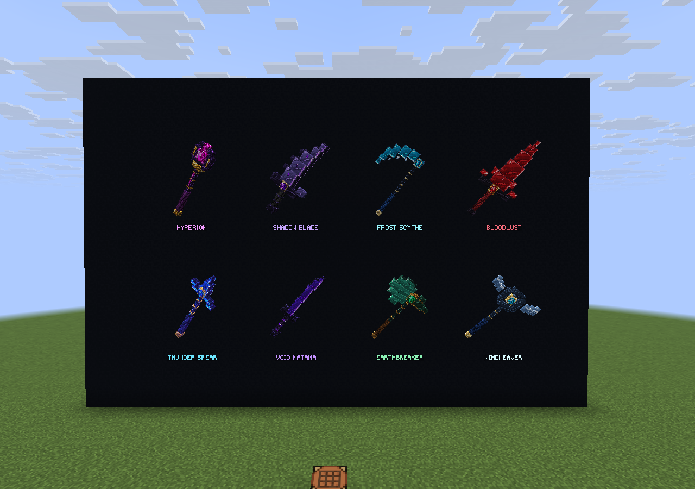
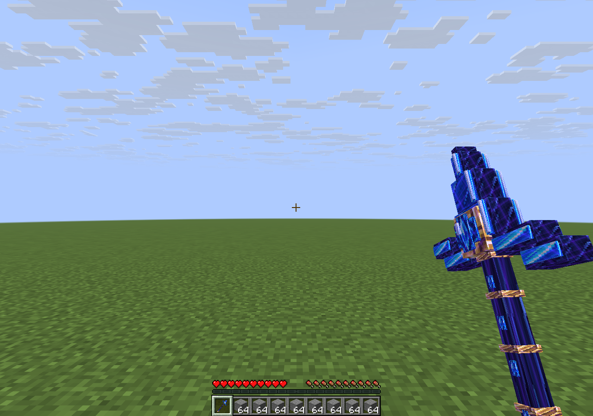

# Modelos de las ocho armas — 2.0.1

Modelos originales inspirados en el estilo de la referencia de inventario: siluetas escalonadas, metal oscuro, bordes vivos y detalles de gemas o runas. El cambio se limita a las ocho armas del plugin independiente. Los assets de cobre permanecen intactos.

| Arma | Diseño |
| --- | --- |
| Bloodlust | Espadón carmesí, guarda con cuernos y rubí central. |
| Frost Scythe | Guadaña de media luna de hielo, dientes y núcleo celeste. |
| Shadow Blade | Hoja curva violeta, espinas y marcas luminosas. |
| Hyperion | Bastón oscuro con jaula dorada y cristal magenta. |
| Windweaver | Maza de aro abierto, alas plateadas y gema celeste. |
| Earthbreaker | Hacha de jade, filo ancho y engaste de esmeralda. |
| Void Katana | Hoja fina y curva, tonos índigo y borde violeta. |
| Thunder Spear | Lanza de una punta, guarda de rayos y detalles azules y dorados. |

Las capturas proceden del cliente oficial 26.2 conectado a Paper 26.2-56. La galería usa ItemDisplay y rótulos de una herramienta de captura instalada exclusivamente en el servidor de pruebas; esa herramienta no forma parte del plugin distribuido. Las ocho armas también se revisaron como iconos de inventario. La lanza de la segunda imagen es el arma reclamada durante la prueba del evento.

## Assets y regeneración

`pack/assets/bigcasares/textures/legendary/material_atlas.png` es una textura original generada con image_gen y conservada sin edición posterior. El atlas nativo `assets/minecraft/atlases/items.json` extrae 64 materiales de 128×128 mediante `minecraft:unstitch`. Agrega únicamente los sprites de las ocho armas al atlas de ítems; no sustituye sprites vanilla.

Desde `standalone/`, `python3 tools/generate_models.py` regenera únicamente la geometría JSON y la configuración del atlas. No modifica píxeles. Los modelos incluyen vistas de inventario, ambas manos, suelo y marcos. Las gemas y runas usan emisión nativa de las caras del modelo, sin shaders ni iluminación dinámica del mundo.

Se conservan los ocho identificadores `bigcasares:<id>`, materiales base, recetas, habilidades, cooldowns y estados persistentes. La actualización no requiere borrar el diario ni volver a fabricar las armas existentes. Sustituye el JAR anterior, reinicia y vuelve a aceptar o cargar el pack actualizado. No dejes las dos versiones del JAR instaladas juntas.

Validación: compilación completa del plugin independiente, **49 pruebas correctas**, sprites y geometría válidos, carga del pack en el cliente y comprobación visual de las ocho armas. Véase [VERIFY.md](VERIFY.md).
