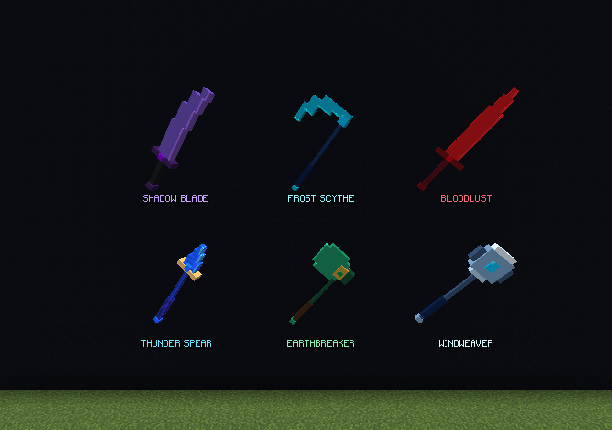

# Modelos simplificados — 2.0.13

Las seis armas actuales tienen una paleta más plana, menos brillos y entre 9 y 12 cuboides por modelo, frente a los 46–76 anteriores. Conservan su identidad: Bloodlust carmesí, Frost Scythe celeste, Shadow Blade violeta, Windweaver plateada, Earthbreaker verde con mango marrón y Thunder Spear azul con guarda dorada.

La imagen es una captura del cliente oficial Java 26.2 conectado a Paper 26.2-133. La galería y sus rótulos pertenecen a una herramienta privada de pruebas, ausente de la distribución.

`pack/assets/bigcasares/textures/legendary/simple_material_atlas.png` es la nueva textura creada con image_gen, conservada sin modificar píxeles. El atlas nativo extrae 48 materiales de 64×64 mediante `minecraft:unstitch`; el atlas anterior y los modelos de las dos armas retiradas se conservan intactos. No se sustituyen texturas vanilla ni de cobre.

Desde `standalone/`, ejecutá `python3 tools/generate_simple_models.py` para regenerar los seis modelos y ambos orígenes del atlas. El script lee las dimensiones del PNG y solo escribe JSON. El generador anterior queda como fuente histórica; ejecutarlo directamente restaura el diseño antiguo.

Esta versión cambia únicamente la apariencia. Conserva los poderes y las reglas de 2.0.12, identificadores de ítems y modelos, recetas, inventarios, cooldowns y diario. Void Katana e Hyperion siguen retiradas. Para actualizar, detené el servidor, sustituí el JAR anterior por 2.0.13 y reiniciá. Aceptá el nuevo pack; no borres datos ni instales ambas versiones juntas.

La galería original se conserva a continuación.

---

# Modelos de las ocho armas — 2.0.1

Esta es una galería histórica. Desde 2.0.12, Void Katana e Hyperion están retiradas del juego. Sus recursos se conservan para representar objetos antiguos al actualizar; no tienen receta ni habilidad activa.

Modelos originales inspirados en el estilo de la referencia de inventario: siluetas escalonadas, metal oscuro, bordes vivos y detalles de gemas o runas. El cambio se limita a las ocho armas del plugin independiente. Los assets de cobre permanecen intactos.

| Arma | Diseño |
| --- | --- |
| Bloodlust | Espadón carmesí, guarda con cuernos y rubí central. |
| Frost Scythe | Guadaña de media luna de hielo, dientes y núcleo celeste. |
| Shadow Blade | Hoja curva violeta, espinas y marcas luminosas. |
| Hyperion | Bastón oscuro con jaula dorada y cristal magenta. |
| Windweaver | Maza de aro abierto, alas plateadas y gema celeste. |
| Earthbreaker | Hacha de jade, filo ancho y engaste de esmeralda. |
| Void Katana | Hoja fina y curva, tonos índigo y borde violeta. |
| Thunder Spear | Lanza de una punta, guarda de rayos y detalles azules y dorados. |

Las capturas proceden del cliente oficial 26.2 conectado a Paper 26.2-56. La galería usa ItemDisplay y rótulos de una herramienta de captura instalada exclusivamente en el servidor de pruebas; esa herramienta no forma parte del plugin distribuido. Las ocho armas también se revisaron como iconos de inventario. La lanza de la segunda imagen es el arma reclamada durante la prueba del evento.

## Assets y regeneración

`pack/assets/bigcasares/textures/legendary/material_atlas.png` es una textura original generada con image_gen y conservada sin edición posterior. El atlas nativo `assets/minecraft/atlases/items.json` extrae 64 materiales de 128×128 mediante `minecraft:unstitch`. Agrega únicamente los sprites de las ocho armas al atlas de ítems; no sustituye sprites vanilla.

Desde `standalone/`, `python3 tools/generate_models.py` regenera únicamente la geometría JSON y la configuración del atlas. No modifica píxeles. Los modelos incluyen vistas de inventario, ambas manos, suelo y marcos. Las gemas y runas usan emisión nativa de las caras del modelo, sin shaders ni iluminación dinámica del mundo.

Se conservan los ocho identificadores `bigcasares:<id>`, materiales base, recetas, habilidades, cooldowns y estados persistentes. La actualización no requiere borrar el diario ni volver a fabricar las armas existentes. Sustituye el JAR anterior, reinicia y vuelve a aceptar o cargar el pack actualizado. No dejes las dos versiones del JAR instaladas juntas.

Validación: compilación completa del plugin independiente, **49 pruebas correctas**, sprites y geometría válidos, carga del pack en el cliente y comprobación visual de las ocho armas. Véase [VERIFY.md](VERIFY.md).
