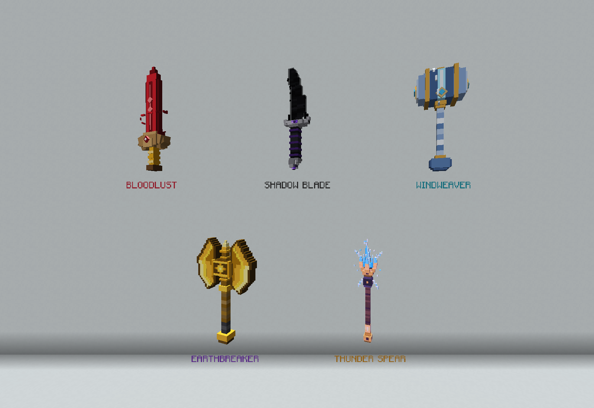

# Modelos vigentes

Las fuentes actuales son los cinco proyectos Blockbench del usuario: Bloodlust,
Shadow Blade, Windweaver, Earthbreaker y Thunder Spear, con once animaciones.
Se conserva una sola copia de cada original y sus texturas incrustadas.
[Archivos originales y exportación](models/reference-study/README.md).

La imagen corresponde a la integración 2.0.15 en el cliente oficial Java 26.2.
La optimización 2.0.16 conserva las superficies y comparte geometría entre poses:
[detalles y validación](PERFORMANCE.md).

El pack conserva los recursos necesarios para representar objetos antiguos de
las armas retiradas. Sus proyectos de diseño y galerías anteriores se consultan
en el [snapshot histórico](https://github.com/benjamingomez-hash/BigC-Paper/blob/e490fb522fbac86636c822ed891c7b7b015383d3/standalone/MODELS.md).

La limpieza del PR elimina borradores y copias derivadas; conserva sin cambios
el pack, el código de juego y los archivos descargables. El JAR final aportado
por el usuario es una entrega compilada distinta de las fuentes 2.0.16:
[procedencia y comprobaciones](VERIFY.md).
