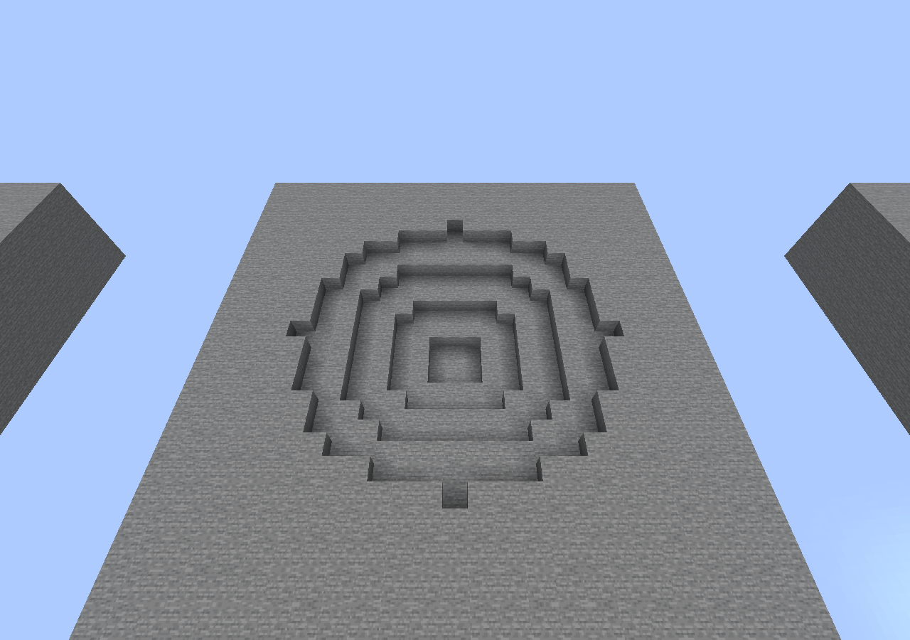

# Verificación de LegendaryWeapons

## 2.0.12: seis armas disponibles

Retiradas Void Katana e Hyperion del catálogo activo, recetas, comandos y poderes.
No se agregaron armas para la segunda semana ni cambios a la apertura del End.
Los identificadores históricos del enum, los registros y los modelos se conservan
para actualizar sin borrar inventarios ni romper la recuperación pendiente.

Java 25, desde `standalone/`:
`bash gradlew --no-daemon --max-workers=4 clean build`.
**80 pruebas correctas, cero fallos, errores o exclusiones**. Se comprobaron
recetas retiradas sin consumir materiales, rechazo de nuevas reservas, lectura
de sesiones antiguas, ausencia de anuncios/protección de mesas retiradas y
confirmación de transacciones históricas de inicio y reclamo.

Paper 26.2-133 y un cliente oficial Java 26.2, con una herramienta privada externa
a la distribución: catálogo, registro de recetas, creación de objetos, lista y
autocompletado contienen exactamente las seis armas. Crear las dos retiradas
falla; los objetos antiguos no activan sesiones, movimiento ni cooldown, incluso
al invocar el punto de activación directamente. El diario y el estado CLAIMED
de Thunder Spear se mantuvieron. La instancia se detuvo y restauró después.

[Actions 39596991130](https://github.com/benjamingomez-hash/BigC-Paper/actions/runs/39596991130)
completó build y pruebas en Windows y cinco análisis Defender sin detecciones:
ZIP, sus tres archivos internos y JAR independiente. Firmas 1.461.118.0,
protección en tiempo real y nube activas, sin exclusiones. Se publican esos
archivos exactos, verificados por SHA-256; sus 83 clases coinciden con las del
JAR probado en Paper.

No se repitieron el evento completo ni todas las pruebas de balance. Los poderes
restantes y los 28 archivos originales del pack se conservaron; el pack mantiene
recursos históricos para objetos ya existentes. Los análisis no diagnostican el
aviso local de Defender de versiones anteriores ni garantizan aceptación en la PC
del usuario.

[Resultados y hashes](docs/six-weapons-verification-2.0.12.json) ·
[Informe Defender](docs/defender-verification-2.0.12.json).

## Reescritura 2.0.11 desde 2.0.5

Base directa: `a1ca1655e082173cde24f1493da91152a4b01d92`. La implementación nueva
separa el robo de vida en `LegendaryLifeSteal`, el pulso del hacha en
`LegendaryEarthShock` y la preparación de Sombras en `LegendaryShadowAmbush`.
Bloodlust observa únicamente golpes directos válidos y consulta la sesión activa.
Earthbreaker mantiene contextos por objetivo y usa daño nativo con cancelación
y tótems. Sombras conserva un plan de destino entre la validación y la ejecución
y calcula el desplazamiento horizontal mediante el ángulo de orientación.

No se incluyen `LegendaryBloodlust` ni `LegendaryFixedDamage` de las versiones
posteriores anteriores. Frente a 2.0.10 hay **siete clases nuevas, tres retiradas
y siete compartidas diferentes**. Se conservan las fuentes de los 28 archivos
del pack y la implementación de parálisis de la lanza de 2.0.5. El plugin raíz,
las recetas y los contratos persistentes no cambian.

Build Java 25 desde `standalone/`:
`bash gradlew --no-daemon --max-workers=4 clean build`.
**77 pruebas correctas, cero fallos, errores y exclusiones**. La suite también
completó su ejecución en Windows.

Paper 26.2-133/Linux, dos clientes oficiales Java 26.2 y herramientas privadas
externas a la distribución: **34 casos nativos correctos**.

- Bloodlust: dos golpes curaron dos puntos en total con Fuerza III; medio corazón
  por golpe a jugadores y mobs permitidos, límite de salud máxima y barrido único.
  Sin curación al expirar, cambiar de arma, cancelar daño/curación, proteger al
  objetivo, absorber todo el daño, usar proyectiles u otras habilidades.
- Hacha: cuatro puntos de salud con armadura, Protección IV, Resistencia V,
  absorción, inmunidad temporal previa y escudo realmente bloqueando. Cancelación,
  protección y distancia exterior impidieron el daño. El tótem funcionó ante un
  golpe letal. El cráter conserva el algoritmo de 2.0.5.
- Sombras: seis puntos mágicos y 2,16 con Protección IV; configuración antigua
  de catorce y ausencia de clave resultaron en seis. Invisibilidad, Velocidad III,
  Debilidad II y Oscuridad aplicadas; veto al daño sin perjuicios; desplazamiento
  de cuatro bloques sin rival y limpieza de efectos al cancelar la sesión.

[Actions 39093766102](https://github.com/benjamingomez-hash/BigC-Paper/actions/runs/39093766102)
analizó el ZIP, sus tres archivos y el JAR independiente: **cinco análisis Defender
sin detecciones**, motor 1.1.26090.9, firmas 1.461.81.0. Protección en tiempo real,
nube, comprimidos, IOAV, scripts y comportamiento activas, sin exclusiones.
Se distribuyen esos mismos archivos, comprobados por SHA-256. Sus 84 clases
coinciden con la compilación probada en Paper. ClamAV 1.4.6 tampoco detectó
amenazas en los dos archivos distribuidos.

Esta implementación es diferente, pero no identifica la causa del aviso local
anterior de Defender ni garantiza que otra PC la acepte. No se ha probado su
instalación en la PC del usuario. La fabricación completa de veinte minutos,
WorldGuard instalado y los escenarios de lanza con clientes no se repitieron
en esta ronda; sus fuentes y pruebas existentes se conservan.

[Resultados nativos y hashes](docs/rewrite-verification-2.0.11.json) ·
[Comparación de clases](docs/rewrite-class-comparison-2.0.11.json) ·
[Informe Defender](docs/defender-verification-2.0.11.json).

## Reconstrucción 2.0.5 — 18 de octubre de 2026 UTC

Desde las fuentes 2.0.3, con la parálisis de Thunder Spear reimplementada. Java 25: `bash gradlew --no-daemon --max-workers=4 clean build`, **66 pruebas, cero fallos, errores o exclusiones**. Gradle genera el ZIP de distribución con tres archivos (JAR, pack, LEEME). Modelos: 28 archivos idénticos a 2.0.3; plugin integrado y cobre sin cambios.

Paper 26.2-133 en Linux con dos clientes oficiales 26.2 y una herramienta privada de instrumentación, no distribuida. La herramienta activa el listener real; W/Space y cámara se ejercitan en ambos clientes. Cuatro casos:

- Impacto contra suelo: lanzador, rival y vaca inmóviles exactamente 200 ticks, desplazamiento máximo cero y cinco rayos visuales; sin daño. Ambos jugadores pueden mirar y vuelven a moverse al terminar.
- Impacto directo: mismos bloqueos; únicamente el rival alcanzado recibe cinco golpes de 7 puntos antes de reducciones. Teletransportes de juego, perlas, chorus y movimiento de mobs bloqueados. AI y gravedad sin cambios.
- Protección: el rival vetado permanece libre y no recibe pulsos eléctricos; lanzador y vaca sí quedan inmóviles. Las caídas posteriores al salir de la plataforma elevada de prueba siguen siendo daño vanilla.
- Cancelación anticipada: libera los tres objetivos y devuelve la lanza. En los cuatro casos: una sola lanza, cero sesiones restantes y ninguna devolución pendiente.

Los siete poderes restantes y fabricación conservan las fuentes 2.0.3; las pruebas nativas detalladas de esas habilidades que figuran más abajo son históricas, no se repitieron en esta reconstrucción. [Datos funcionales](docs/rebuild-verification-2.0.5.json).

Windows Actions compiló y probó las mismas fuentes. Los 77 archivos de clases coinciden con el JAR probado en Linux; los cambios de recursos son únicamente finales de línea del checkout. Se publican los archivos exactos del runner. Cinco análisis de Defender (ZIP, tres miembros y JAR) sin detecciones, con protección activa, nube conectada y sin exclusiones. ClamAV tampoco detectó amenazas. **Esto no reproduce la instalación en la PC del usuario ni resuelve el diagnóstico de 2.0.4.** [Revisión y límites](SECURITY-REBUILD-2.0.5.md) · [Informe Defender](docs/defender-verification-2.0.5.json).

## Automatización

- `standalone/`: `bash gradlew --no-daemon --max-workers=4 clean build`, Java 25, **46 pruebas sin fallos, errores ni exclusiones**.
- Repositorio raíz: mismo comando, **1.014 pruebas sin fallos, errores ni exclusiones**. No se modifican sus fuentes, dependencias ni módulos.
- El JAR independiente no contiene el entrypoint BigCasares ni declara dependencias obligatorias. Incluye el pack Java y las ocho definiciones de modelo, con referencias resueltas. No contiene `LegendaryAltars`.

## Cliente y servidor reales

Paper **26.2-56**, un único plugin de producción (`LegendaryWeapons 2.0.0`), cliente oficial Java **26.2**, entorno local aislado. El usuario de prueba inicial y el que reclama son diferentes. No se utilizó ningún servidor de jugadores real.

1. Se colocó la receta de Thunder Spear en la mesa vanilla: lanza de netherite, cuatro pararrayos, dos corazones del mar y dos bloques de cobre. El resultado era únicamente una vista previa de inicio.
2. Al hacer clic, se consumieron los nueve materiales. El inventario del fabricante quedó vacío; no había ItemDisplay de arma. Se mostró el anuncio de inicio sin coordenadas y un TextDisplay con `Thunder Spear` y el contador.
3. La mesa resistió una rotura en creativo. Matar y desconectar al fabricante no canceló el estado CRAFTING.
4. Se detuvo Paper y se adelantaron exclusivamente los tiempos del diario de la instancia de prueba a 5/10/15/20 minutos transcurridos, reiniciando entre fases. **No se esperaron veinte minutos seguidos en esta prueba manual**; los límites exactos de milisegundos se verifican mediante las pruebas automatizadas. No existe un comando ni configuración de producción para acortar el evento.
5. Los límites persistidos se mantuvieron en cada reinicio:

| Pista | X inclusiva | Z inclusiva |
| --- | --- | --- |
| 1.000×1.000 | -453 a 546 | -880 a 119 |
| 500×500 | 2 a 501 | -387 a 112 |
| Coordenadas exactas | 100 | 102 (Y: -60) |

La zona interior está completamente dentro de la exterior. Ambas incluyen la mesa; se anunció Overworld. No se repitieron los avisos ya confirmados.

6. READY_TO_CLAIM quedó registrado tras el reinicio sin cargar el chunk de la mesa. Al acercar al segundo usuario, apareció el modelo horizontal sobre la mesa.
7. Con el inventario lleno de 2.304 bloques de piedra, el reclamo se rechazó y el arma continuó disponible. Tras liberar un espacio, ese segundo usuario obtuvo una sola `NETHERITE_SPEAR`, con `minecraft:lunge: 3`, modelo `bigcasares:thunder_spear` e identidad de instancia persistente.
8. El estado pasó a CLAIMED. El anuncio fue únicamente «THUNDER SPEAR HA SIDO RECLAMADA», sin nombre. El ItemDisplay y la Interaction desaparecieron.
9. El arma obtenida se lanzó con clic derecho; ocupó temporalmente su espacio con el recibo y regresó como una única lanza. El estado global permaneció CLAIMED. Tras otro reinicio y reconexión, el jugador conservó exactamente una lanza, el estado siguió CLAIMED y no se repitieron los anuncios de aparición o reclamo.

## Alcance

La concurrencia de dieciséis reclamos se probó sobre el coordinador persistente mediante hilos; la prueba manual usó dos identidades sucesivas, no dos clientes atacando simultáneamente. Las ocho recetas y la aritmética de consumo tienen pruebas automatizadas; el recorrido manual completo usó Thunder Spear. WorldGuard, combate PvP con varios clientes, Windows nativo y Bedrock no se probaron en esta instancia Linux. La rama de persistencia Windows se probó mediante su adaptador de plataforma.

En Windows Java no permite abrir directorios como FileChannel: se fuerzan los archivos y se exige renombrado atómico, pero no se realiza fsync adicional del directorio. Las garantías frente a cortes de energía dependen del sistema de archivos; conservar copias de seguridad coherentes de diario y jugadores.

## Ejemplo de los avisos de coordenadas

La siguiente captura reproduce en el cliente real los mensajes del formateador del plugin para las fases de 5, 10 y 15 minutos, usando las zonas persistidas de la prueba. Se añadieron rótulos «MINUTO 5/10/15» para distinguir las fases en una sola imagen. Esta captura es demostrativa; no corresponde a veinte minutos consecutivos de juego.

## Actualización visual 2.0.1 — 16 de octubre de 2026

- Compilación completa del plugin independiente con Java 25: **49 pruebas, 0 fallos, 0 errores y 0 exclusiones**. Las tres pruebas añadidas verifican los recortes del atlas, las referencias y límites de la geometría, y la conservación de los ocho identificadores de modelo.
- Paper 26.2-56 cargó LegendaryWeapons 2.0.1; el cliente oficial Java 26.2 descargó su pack y renderizó las ocho armas en una galería de ItemDisplay y en una vista de inventario. Se comprobó Thunder Spear en primera persona con el arma previamente reclamada.
- El cliente se inició con `mipmapLevels:4`. El atlas de bloques conservó sus cuatro niveles; el atlas de ítems usó el nivel cero nativo de esta versión. No hubo errores de modelos, sprites o texturas del pack. La instancia sin dispositivo de audio y sin conexión a los servicios de sesión registró avisos ajenos al renderizado del pack.
- Los archivos de cobre se compararon por SHA-256 con la instantánea anterior al rediseño y permanecen idénticos. No se modificó código de jugabilidad ni archivos de los módulos del plugin raíz.
- La herramienta auxiliar que coloca la galería solo se usa en la instancia aislada de pruebas y no se incluye en el JAR ni en esta rama.

Capturas y detalles: [MODELS.md](MODELS.md). Esta actualización visual no repite el recorrido completo de fabricación descrito arriba; conserva su implementación y ejecuta nuevamente sus pruebas automatizadas.

## Corrección de habilidades 2.0.2 — 17 de octubre de 2026

Compilación completa desde `standalone/`: `bash gradlew --no-daemon --max-workers=4 clean build`, Java 25, **59 pruebas correctas, sin errores ni exclusiones**. Se añadieron regresiones de las tres ondas, reintento tras inmunidad o cancelación, fin del daño antes de expirar los estados negativos, alcance terrestre, impulso sin acumular velocidad y propiedad de Fuerza III.

La instancia real de esta ronda usa **Paper 26.2-133 estable** y cliente oficial Java **26.2**. La dependencia de compilación se conserva en `26.2.build.56-alpha`. Se cargó el JAR independiente 2.0.2 con una herramienta de pruebas externa, que crea ítems mediante la factoría de producción y dispara el mismo listener de clic derecho. La herramienta no se incluye en el ZIP ni en el JAR distribuido.

### Daño observado

Objetivo controlado: zombi hostil inmóvil, 200 puntos de salud para sobrevivir a todos los pulsos, cuatro piezas de netherite. Se conserva su armadura natural de zombi. La herramienta lo mantiene dentro del área de cada pulso; las cifras son acumulados de esta prueba, no una predicción de daño inevitable contra jugadores. Dos puntos equivalen a un corazón.

| Habilidad | 2.0.1, netherite | 2.0.2, netherite | 2.0.2, netherite + Protección IV en las cuatro piezas |
| --- | ---: | ---: | ---: |
| Earthbreaker | 2,592 | 24 (tres golpes) | 8,64 |
| Frost Scythe | 4 | 32 (ocho golpes) | 11,52 |
| Hyperion | 4,592 | 32 (impacto y cinco pulsos) | 11,52 |
| Shadow Blade, al activarse | 0,0002 | 10 | 3,6 |

Los eventos de los cuatro hechizos registran `minecraft:magic` atribuido al jugador; Protección IV conserva su reducción nativa. Cancelar `EntityDamageByEntityEvent` produjo **cero daño, elevación, lentitud, oscuridad y congelación** en esas cuatro habilidades. La prueba de Earthbreaker con inmunidad temporal inicial produjo sus tres impactos al poder recibir daño, en lugar de perder la primera onda. El terremoto deja de emitir ondas a los tres segundos y conserva sus efectos temporales hasta que expiran, sin generar una cuarta onda.

### Fuerza, impulso y maza

- Bloodlust aplicó amplificador **2 (Fuerza III)** por **200 ticks** y expiró. Un efecto previo de Fuerza IV siguió intacto; uno previo de Fuerza I volvió a estar activo después de terminar el refuerzo. El doble clic de prueba no duplicó la activación.
- Wind charge vanilla detonada cerca de los pies sobre suelo llano: velocidad vertical inicial aproximada **1,091**, altura **6,91 bloques**. Windweaver: **1,3** y **9,43 bloques**, conservando el movimiento horizontal.
- En la primera caída normal de Windweaver, el evento de daño por caída quedó cancelado y el jugador conservó sus veinte puntos de salud. El salto conserva la distancia de caída para el smash nativo; se verificó el ataque de maza durante el descenso.
- Una interacción denegada no aplicó Fuerza ni produjo el impulso.

Las mediciones y los eventos de las pruebas están en [ability-verification-2.0.2.json](docs/ability-verification-2.0.2.json). Los archivos de modelos y pack se compararon con los incluidos en 2.0.1 y permanecen iguales. Se conserva el código de Void Katana, la tormenta de Thunder Spear, sus controles y su devolución.

Esta ronda no repite el evento completo de veinte minutos ni una partida PvP entre varios jugadores: prueba las habilidades desde un cliente conectado contra objetivos controlados en Paper. Las pruebas existentes de fabricación, diario, reclamo, devolución, cooldowns y modelos se ejecutaron en la compilación completa. WorldGuard y servidores de terceros no se probaron en vivo en esta ronda.

## Poderes nuevos 2.0.3 — 17 de octubre de 2026

Compilación completa desde `standalone/`: `bash gradlew --no-daemon --max-workers=4 clean build`, Java 25, **60 pruebas correctas, sin fallos, errores ni exclusiones**. Se sustituyeron las pruebas de ondas antiguas por geometría circular, profundidad escalonada, simetría, trabajo limitado por tick y ráfaga de exactamente cinco disparos.

Se usó el cliente oficial Java 26.2 conectado a Paper 26.2-133. Una herramienta externa invoca el listener real con ítems de la factoría de producción, crea objetivos y plataformas desechables, y registra efectos, proyectiles, explosiones y roturas. No forma parte del plugin ni del ZIP. Doce casos nativos y mediciones se conservan en [power-verification-2.0.3.json](docs/power-verification-2.0.3.json).

- **Frost:** vaca, aldeano, lobo domesticado, zombi y soporte de armadura recibieron amplificador 3 (**Lentitud IV**) y hasta **180 ticks de congelación**. La vaca invulnerable recibió ambos estados sin perder salud, demostrando que no dependen de que un golpe haga daño. El lanzador no recibió congelación ni lentitud. Un veto de `LegendaryProtectionEvent` impidió los dos estados en los cinco tipos. Solo se registró daño vanilla `minecraft:freeze`, sin golpes mágicos de la habilidad.
- **Hyperion:** se observaron cinco entidades **FIREBALL**, a intervalos de cinco ticks. La prueba de pared produjo cinco explosiones reales con destrucción de netherrack. Una vaca pasiva recibió daño nativo `minecraft:fireball` y `minecraft:player_explosion`. El veto directo de un objetivo eliminó los cinco proyectiles sin explosión; otra vaca protegida junto a las explosiones conservó su salud. Una pared con rotura cancelada quedó intacta, aunque las cinco bolas detonaron. La limpieza de sesión retiró los proyectiles activos. Para aislar su expiración, se mantuvieron cinco bolas inmóviles en el aire mediante la herramienta: seguían vivas al tick 90 y habían desaparecido al finalizar, sin explotar.
- **Earthbreaker:** en una plataforma maciza eliminó exactamente **360 bloques de 197 columnas**, ninguno fuera del radio ocho. Profundidades medidas a distancias 0/2/4/6/8/9: **4/3/2/1/1/0**. Con protecciones dejó intactos bedrock, un cofre con sus tres diamantes, columnas vetadas por el evento de protección y por `BlockBreakEvent`, y una mesa registrada en un evento de fabricación real de la instancia. La mesa continuó protegida; el total retirado bajó a 352. El objetivo pasivo cercano no recibió golpes; el único daño registrado fue un punto de caída vanilla del jugador al desaparecer su suelo.

La captura es del cliente sin editar; la plataforma elevada permite medir todos los niveles sin alcanzar bedrock. El mundo, la mesa y los objetivos son fixtures de prueba. El diario original de esa instancia se restaura después de detener el servidor; no se altera ningún servidor de jugadores.

Se conservan los modelos y la implementación de Bloodlust, Windweaver, Shadow Blade, Void Katana y Thunder Spear. No se repitió la fabricación completa de veinte minutos ni una partida entre varios clientes. Se verificaron cancelaciones mediante eventos nativos y el evento público de protección; WorldGuard instalado no se probó en vivo.
