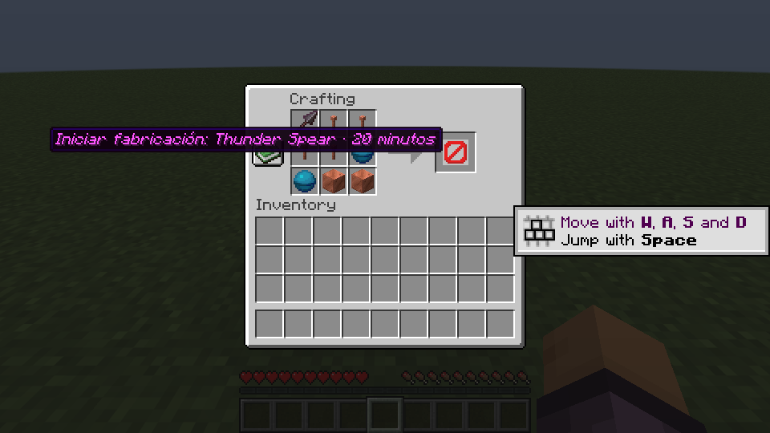
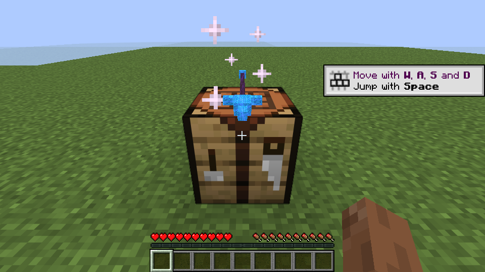
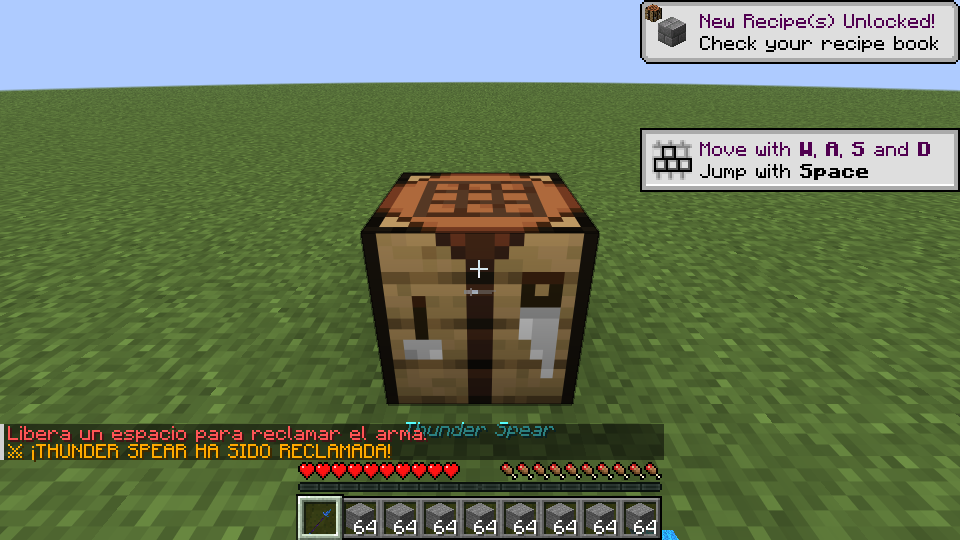
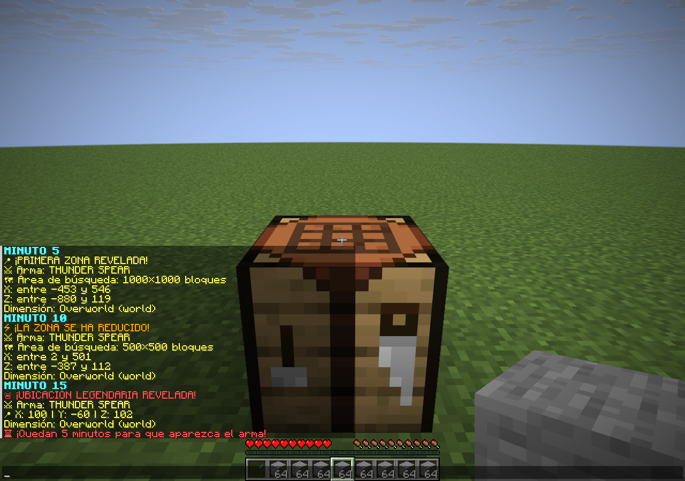

# Verificación — 16 de octubre de 2026

## Automatización

- `standalone/`: `bash gradlew --no-daemon --max-workers=4 clean build`, Java 25, **46 pruebas sin fallos, errores ni exclusiones**.
- Repositorio raíz: mismo comando, **1.014 pruebas sin fallos, errores ni exclusiones**. No se modifican sus fuentes, dependencias ni módulos.
- El JAR independiente no contiene el entrypoint BigCasares ni declara dependencias obligatorias. Incluye el pack Java y las ocho definiciones de modelo, con referencias resueltas. No contiene `LegendaryAltars`.

## Cliente y servidor reales

Paper **26.2-56**, un único plugin de producción (`LegendaryWeapons 2.0.0`), cliente oficial Java **26.2**, entorno local aislado. El usuario de prueba inicial y el que reclama son diferentes. No se utilizó ningún servidor de jugadores real.

1. Se colocó la receta de Thunder Spear en la mesa vanilla: lanza de netherite, cuatro pararrayos, dos corazones del mar y dos bloques de cobre. El resultado era únicamente una vista previa de inicio.
2. Al hacer clic, se consumieron los nueve materiales. El inventario del fabricante quedó vacío; no había ItemDisplay de arma. Se mostró el anuncio de inicio sin coordenadas y un TextDisplay con `Thunder Spear` y el contador.
3. La mesa resistió una rotura en creativo. Matar y desconectar al fabricante no canceló el estado CRAFTING.
4. Se detuvo Paper y se adelantaron exclusivamente los tiempos del diario de la instancia de prueba a 5/10/15/20 minutos transcurridos, reiniciando entre fases. **No se esperaron veinte minutos seguidos en esta prueba manual**; los límites exactos de milisegundos se verifican mediante las pruebas automatizadas. No existe un comando ni configuración de producción para acortar el evento.
5. Los límites persistidos se mantuvieron en cada reinicio:

| Pista | X inclusiva | Z inclusiva |
| --- | --- | --- |
| 1.000×1.000 | -453 a 546 | -880 a 119 |
| 500×500 | 2 a 501 | -387 a 112 |
| Coordenadas exactas | 100 | 102 (Y: -60) |

La zona interior está completamente dentro de la exterior. Ambas incluyen la mesa; se anunció Overworld. No se repitieron los avisos ya confirmados.

6. READY_TO_CLAIM quedó registrado tras el reinicio sin cargar el chunk de la mesa. Al acercar al segundo usuario, apareció el modelo horizontal sobre la mesa.
7. Con el inventario lleno de 2.304 bloques de piedra, el reclamo se rechazó y el arma continuó disponible. Tras liberar un espacio, ese segundo usuario obtuvo una sola `NETHERITE_SPEAR`, con `minecraft:lunge: 3`, modelo `bigcasares:thunder_spear` e identidad de instancia persistente.
8. El estado pasó a CLAIMED. El anuncio fue únicamente «THUNDER SPEAR HA SIDO RECLAMADA», sin nombre. El ItemDisplay y la Interaction desaparecieron.
9. El arma obtenida se lanzó con clic derecho; ocupó temporalmente su espacio con el recibo y regresó como una única lanza. El estado global permaneció CLAIMED. Tras otro reinicio y reconexión, el jugador conservó exactamente una lanza, el estado siguió CLAIMED y no se repitieron los anuncios de aparición o reclamo.

## Alcance

La concurrencia de dieciséis reclamos se probó sobre el coordinador persistente mediante hilos; la prueba manual usó dos identidades sucesivas, no dos clientes atacando simultáneamente. Las ocho recetas y la aritmética de consumo tienen pruebas automatizadas; el recorrido manual completo usó Thunder Spear. WorldGuard, combate PvP con varios clientes, Windows nativo y Bedrock no se probaron en esta instancia Linux. La rama de persistencia Windows se probó mediante su adaptador de plataforma.

En Windows Java no permite abrir directorios como FileChannel: se fuerzan los archivos y se exige renombrado atómico, pero no se realiza fsync adicional del directorio. Las garantías frente a cortes de energía dependen del sistema de archivos; conservar copias de seguridad coherentes de diario y jugadores.

## Ejemplo de los avisos de coordenadas

La siguiente captura reproduce en el cliente real los mensajes del formateador del plugin para las fases de 5, 10 y 15 minutos, usando las zonas persistidas de la prueba. Se añadieron rótulos «MINUTO 5/10/15» para distinguir las fases en una sola imagen. Esta captura es demostrativa; no corresponde a veinte minutos consecutivos de juego.

## Actualización visual 2.0.1 — 16 de octubre de 2026

- Compilación completa del plugin independiente con Java 25: **49 pruebas, 0 fallos, 0 errores y 0 exclusiones**. Las tres pruebas añadidas verifican los recortes del atlas, las referencias y límites de la geometría, y la conservación de los ocho identificadores de modelo.
- Paper 26.2-56 cargó LegendaryWeapons 2.0.1; el cliente oficial Java 26.2 descargó su pack y renderizó las ocho armas en una galería de ItemDisplay y en una vista de inventario. Se comprobó Thunder Spear en primera persona con el arma previamente reclamada.
- El cliente se inició con `mipmapLevels:4`. El atlas de bloques conservó sus cuatro niveles; el atlas de ítems usó el nivel cero nativo de esta versión. No hubo errores de modelos, sprites o texturas del pack. La instancia sin dispositivo de audio y sin conexión a los servicios de sesión registró avisos ajenos al renderizado del pack.
- Los archivos de cobre se compararon por SHA-256 con la instantánea anterior al rediseño y permanecen idénticos. No se modificó código de jugabilidad ni archivos de los módulos del plugin raíz.
- La herramienta auxiliar que coloca la galería solo se usa en la instancia aislada de pruebas y no se incluye en el JAR ni en esta rama.

Capturas y detalles: [MODELS.md](MODELS.md). Esta actualización visual no repite el recorrido completo de fabricación descrito arriba; conserva su implementación y ejecuta nuevamente sus pruebas automatizadas.

## Corrección de habilidades 2.0.2 — 17 de octubre de 2026

Compilación completa desde `standalone/`: `bash gradlew --no-daemon --max-workers=4 clean build`, Java 25, **59 pruebas correctas, sin errores ni exclusiones**. Se añadieron regresiones de las tres ondas, reintento tras inmunidad o cancelación, fin del daño antes de expirar los estados negativos, alcance terrestre, impulso sin acumular velocidad y propiedad de Fuerza III.

La instancia real de esta ronda usa **Paper 26.2-133 estable** y cliente oficial Java **26.2**. La dependencia de compilación se conserva en `26.2.build.56-alpha`. Se cargó el JAR independiente 2.0.2 con una herramienta de pruebas externa, que crea ítems mediante la factoría de producción y dispara el mismo listener de clic derecho. La herramienta no se incluye en el ZIP ni en el JAR distribuido.

### Daño observado

Objetivo controlado: zombi hostil inmóvil, 200 puntos de salud para sobrevivir a todos los pulsos, cuatro piezas de netherite. Se conserva su armadura natural de zombi. La herramienta lo mantiene dentro del área de cada pulso; las cifras son acumulados de esta prueba, no una predicción de daño inevitable contra jugadores. Dos puntos equivalen a un corazón.

| Habilidad | 2.0.1, netherite | 2.0.2, netherite | 2.0.2, netherite + Protección IV en las cuatro piezas |
| --- | ---: | ---: | ---: |
| Earthbreaker | 2,592 | 24 (tres golpes) | 8,64 |
| Frost Scythe | 4 | 32 (ocho golpes) | 11,52 |
| Hyperion | 4,592 | 32 (impacto y cinco pulsos) | 11,52 |
| Shadow Blade, al activarse | 0,0002 | 10 | 3,6 |

Los eventos de los cuatro hechizos registran `minecraft:magic` atribuido al jugador; Protección IV conserva su reducción nativa. Cancelar `EntityDamageByEntityEvent` produjo **cero daño, elevación, lentitud, oscuridad y congelación** en esas cuatro habilidades. La prueba de Earthbreaker con inmunidad temporal inicial produjo sus tres impactos al poder recibir daño, en lugar de perder la primera onda. El terremoto deja de emitir ondas a los tres segundos y conserva sus efectos temporales hasta que expiran, sin generar una cuarta onda.

### Fuerza, impulso y maza

- Bloodlust aplicó amplificador **2 (Fuerza III)** por **200 ticks** y expiró. Un efecto previo de Fuerza IV siguió intacto; uno previo de Fuerza I volvió a estar activo después de terminar el refuerzo. El doble clic de prueba no duplicó la activación.
- Wind charge vanilla detonada cerca de los pies sobre suelo llano: velocidad vertical inicial aproximada **1,091**, altura **6,91 bloques**. Windweaver: **1,3** y **9,43 bloques**, conservando el movimiento horizontal.
- En la primera caída normal de Windweaver, el evento de daño por caída quedó cancelado y el jugador conservó sus veinte puntos de salud. El salto conserva la distancia de caída para el smash nativo; se verificó el ataque de maza durante el descenso.
- Una interacción denegada no aplicó Fuerza ni produjo el impulso.

Las mediciones y los eventos de las pruebas están en [ability-verification-2.0.2.json](docs/ability-verification-2.0.2.json). Los archivos de modelos y pack se compararon con los incluidos en 2.0.1 y permanecen iguales. Se conserva el código de Void Katana, la tormenta de Thunder Spear, sus controles y su devolución.

Esta ronda no repite el evento completo de veinte minutos ni una partida PvP entre varios jugadores: prueba las habilidades desde un cliente conectado contra objetivos controlados en Paper. Las pruebas existentes de fabricación, diario, reclamo, devolución, cooldowns y modelos se ejecutaron en la compilación completa. WorldGuard y servidores de terceros no se probaron en vivo en esta ronda.
